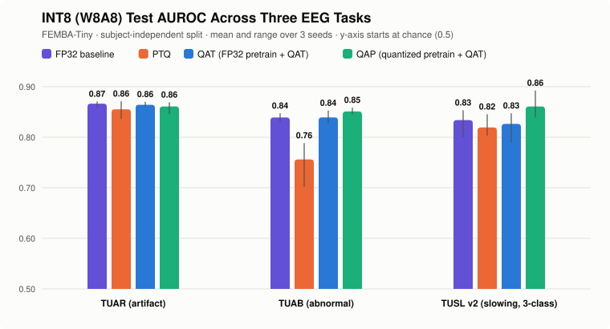
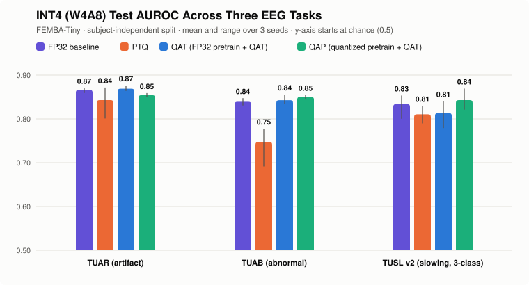

<div align="center">

# FEMBA-Tiny: Low-Bit Quantization and Bitwidth Thresholds

Compares three quantization pipelines on FEMBA-Tiny (bidirectional Mamba for EEG, 8.67M parameters): post-training quantization (PTQ), FP32 pretraining followed by quantization-aware training (QAT), and quantization-aware pretraining plus fine-tuning (QAP). Evaluated on TUAR (artifact detection), TUAB (abnormal detection), and TUSL (3-class slowing) from the TUH EEG Corpus, focusing on INT8 (W8A8) and INT4 (W4A8) failure diagnosis, channel migration, and bitwidth limits.

**TUAB test AUROC: PTQ 0.76, QAT 0.84, QAP 0.85 · INT4 footprint 4.85 MB (7.1×) with no accuracy drop · QAP matches QAT**


[](LICENSE)

**English** | [简体中文](README.zh.md) · [Key findings](#key-findings) · [INT8](#1-int8-w8a8-results) · [INT4](#2-int4-w4a8-results) · [PTQ diagnosis](#3-ptq-drop-diagnosis-and-layer-wise-attribution) · [Cost](#4-compression-compute-and-training-cost) · [Reproduce](#5-reproduction-and-repo-layout) · [Data index](#6-data-and-script-index)

<picture>
  <source media="(prefers-color-scheme: dark)" srcset="reproduction/figures/formal-overview-en-dark.svg">
  
</picture>

</div>

This formal suite uses a subject-independent split (pretrained on the official TUAB training set after excluding all downstream test subjects) across fixed seeds 42, 43, and 44 under Brevitas fake quantization. `QAT` adds an FP32-pretrained baseline followed by quantized fine-tuning to isolate whether pretraining itself must be quantized. Reported metrics cover AUROC, balanced accuracy (BAcc), expected calibration error (ECE, 15 equal-width bins), and bit-operations (BOPs). Detailed per-experiment sub-reports under `reproduction/formal_line/results/` are in Chinese, paired with machine-readable JSON summaries and Python verification scripts.

## Key findings

| Question | Finding and core numbers | Source |
| --- | --- | --- |
| **At which bitwidth does QAP beat PTQ?** | Both INT8 and INT4 outperform PTQ (`+0.10` AUROC and `+0.12` BAcc on TUAB; `+0.19` BAcc on TUSL; tied on TUAR after threshold re-selection). | [INT8](reproduction/formal_line/results/int8/README.md) · [INT4](reproduction/formal_line/results/int4/README.md) |
| **Should quantization-aware methods replace PTQ?** | Yes, though **QAT (quantized fine-tuning)** suffices: QAT recovers the same accuracy, and QAP shows no consistent lead over QAT. | [§1](#1-int8-w8a8-results) · [§2](#2-int4-w4a8-results) |
| **Bitwidths where QAP justifies pretraining cost** | Neither 8-bit nor 4-bit. QAT reuses one FP32 pretraining run (`2.59 h`), whereas QAP re-runs pretraining per bitwidth (~`3.0 h` normalized). | [Pretraining cost](reproduction/formal_line/results/metrics/README.md#预训练成本) |
| **Where QAP helps most layer-wise** | **The 2nd Mamba block** (76% of the INT8 drop reduction and 72% of INT4), led by its backward scan output; QAT and QAP both keep clipping there `≤ 0.02%` (vs `4%` under PTQ). | [Layer analysis](reproduction/formal_line/results/layers/README.md) |
| **Deployment recommendation** | Use **INT4 + QAT** (47% less storage and 25% fewer total BOPs than INT8; AUROC within `0.03` of FP32). When restricted to PTQ, migrating 2nd-block outliers via SmoothQuant recovers `82%` (INT8) and `57%` (INT4) of the TUAB drop. | [§4](#4-compression-compute-and-training-cost) · [PTQ diagnosis](reproduction/formal_line/results/ptq-diagnosis/README.md) |
| **Three additional baselines** | **BF16 / FP16** match FP32; **PTQ** is in §1–§2; **Random Init** (quantized fine-tuning from scratch) matches pretrained runs on TUAB/TUAR but drops `0.07–0.08` on TUSL (excl. fold 0). | [FP16/BF16](reproduction/formal_line/results/metrics/README.md#fp16-和-bf16) · [Random init](reproduction/formal_line/results/metrics/README.md#随机初始化) |
| **Cost and calibration metrics** | BAcc and ECE are in §1–§2; effective bits per parameter are `8.40 / 4.48 / 2.52 bit` and total BOPs per 5 s window are `86.4 / 64.7 / 53.8 G` (INT8 / INT4 / Ternary, theoretical). | [Metrics & cost](reproduction/formal_line/results/metrics/README.md) |
| **Comparison with *FEMBA on the Edge*** | Matches the paper's trend (paper TUAB W8A8/W4A8 PTQ `0.77 / 0.71` → QAT `0.88`; ours PTQ `0.76 / 0.75` → QAT/QAP `0.84–0.85`). The paper pretrains on TUEG; this suite pretrains 2 epochs on TUAB and fine-tunes on 1/5 of subjects. | [Protocol diff](reproduction/formal_line/results/int8/README.md#与上游协议的差异) |
| **Bitwidth cross-comparison** | Full per-seed INT8 and INT4 tables are in the two result reports. | [INT8](reproduction/formal_line/results/int8/README.md) · [INT4](reproduction/formal_line/results/int4/README.md) |

## 1. INT8 (W8A8) results

Test-set means across three random seeds (two decimals; BAcc uses default threshold `0` on TUAR/TUAB and argmax on TUSL v2; `Random Init` runs quantized fine-tuning without pretraining):

| Task | Metric | FP32 | PTQ | QAT | QAP | Random Init |
| --- | --- | ---: | ---: | ---: | ---: | ---: |
| **TUAR** | AUROC ↑ | 0.87 | 0.86 | 0.86 | 0.86 | **0.87** |
| | Balanced Acc (BAcc) ↑ | 0.75 | 0.63 | **0.76** | **0.76** | **0.76** |
| | Calibration Error (ECE) ↓ | 0.10 | 0.17 | 0.08 | 0.09 | **0.08** |
| **TUAB** | AUROC ↑ | 0.84 | 0.76 | 0.84 | **0.85** | **0.85** |
| | Balanced Acc (BAcc) ↑ | 0.76 | 0.65 | 0.76 | **0.77** | **0.77** |
| | Calibration Error (ECE) ↓ | 0.03 | 0.06 | **0.02** | **0.02** | 0.03 |
| **TUSL v2** | Macro AUROC ↑ | 0.83 | 0.82 | 0.83 | **0.86** | 0.82 |
| **TUSL v2 (excl. fold 0)** | Macro AUROC ↑ | **0.91** | 0.89 | 0.90 | 0.90 | 0.83 |
| **TUSL v2** | Macro BAcc ↑ | 0.68 | 0.51 | 0.67 | **0.70** | 0.68 |
| | Calibration Error (ECE) ↓ | 0.11 | 0.16 | 0.12 | **0.05** | 0.12 |

Re-selecting the decision threshold on the validation set restores PTQ BAcc to `0.75` on TUAR and `0.70` on TUAB (other arms change by `≤ 0.01`). Four-decimal tables and paired differences are in [INT8 full results](reproduction/formal_line/results/int8/README.md) and [Metrics & cost](reproduction/formal_line/results/metrics/README.md).

- **PTQ threshold shift:** On TUAR seed 42, PTQ predicts all positives at threshold `0` (BAcc `0.50`, ECE `0.33`) and recovers to `0.73` after validation threshold tuning; on TUAB, PTQ trails QAT and QAP by `0.07–0.12` under both thresholds.
- **TUSL v2 single-subject bias:** Fold 0 of TUSL's four test folds (46 of 55 events from a single subject) accounts for the `+0.03` gap across all folds. Excluding fold 0, QAT and QAP tie on macro AUROC (`0.9032` vs `0.9032`) and both beat Random Init (`0.8272`) by `+0.08`.

## 2. INT4 (W4A8) results

Dropping weights to 4 bits with 8-bit activations keeps QAT and QAP at FP32 accuracy:

<div align="center">
<picture>
  <source media="(prefers-color-scheme: dark)" srcset="reproduction/figures/formal-overview-int4-en-dark.svg">
  
</picture>
</div>

| Task | Metric | FP32 | PTQ | QAT | QAP | Random Init |
| --- | --- | ---: | ---: | ---: | ---: | ---: |
| **TUAR** | AUROC ↑ | **0.87** | 0.84 | **0.87** | 0.85 | **0.87** |
| | Balanced Acc (BAcc) ↑ | 0.75 | 0.57 | **0.76** | 0.75 | **0.76** |
| | Calibration Error (ECE) ↓ | 0.10 | 0.24 | 0.09 | 0.09 | **0.08** |
| **TUAB** | AUROC ↑ | 0.84 | 0.75 | 0.84 | **0.85** | **0.85** |
| | Balanced Acc (BAcc) ↑ | 0.76 | 0.65 | **0.77** | **0.77** | **0.77** |
| | Calibration Error (ECE) ↓ | 0.03 | 0.09 | **0.02** | **0.02** | 0.03 |
| **TUSL v2** | Macro AUROC ↑ | 0.83 | 0.81 | 0.81 | **0.84** | 0.82 |
| **TUSL v2 (excl. fold 0)** | Macro AUROC ↑ | **0.91** | 0.88 | 0.90 | 0.90 | 0.83 |
| **TUSL v2** | Macro BAcc ↑ | **0.68** | 0.49 | 0.65 | **0.68** | **0.68** |
| | Calibration Error (ECE) ↓ | 0.11 | 0.18 | **0.09** | **0.09** | 0.11 |

After validation threshold tuning, PTQ BAcc recovers to `0.74` on TUAR and `0.69` on TUAB. See [INT4 full results](reproduction/formal_line/results/int4/README.md).

- **47% less storage and 50% fewer quantized-layer BOPs without losing accuracy:** Footprint drops from `9.10 MB` to `4.85 MB` and quantized-layer BOPs drop from `43.6 G` to `21.8 G` (`86.4 → 64.7 G` total), while QAT and QAP stay within `0.02` AUROC across all three tasks.
- **QAT still matches QAP:** `QAP − QAT` test AUROC is negative on all three seeds on TUAR (mean `−0.015`), `+0.008` on TUAB (negative on seed 44), and `+0.003` on TUSL v2 excluding fold 0 (negative on seed 44). Down to 4-bit weights, QAT from a shared FP32 checkpoint matches QAP.

## 3. PTQ drop diagnosis and layer-wise attribution

On TUAB, W8A8 PTQ trails FP32 by `0.08` (`0.84 → 0.76`). Splitting weight vs. activation quantization and ablating all 35 quantizers isolates the cause:

| TUAB setting | Weight width | Activation width | Test AUROC | vs. FP32 |
| --- | --- | --- | ---: | ---: |
| **FP32 baseline** | FP32 | FP32 | 0.84 | — |
| **8-bit weights only (W8A32)** | 8 bit | FP32 | 0.84 | 0.00 |
| **4-bit weights only (W4A32)** | 4 bit | FP32 | 0.83 | −0.01 |
| **Ternary weights only** | 2 bit | FP32 | 0.60 | −0.24 |
| **8-bit activations only (W32A8)** | FP32 | 8 bit | 0.76 | −0.08 |
| **Standard W8A8 PTQ (95th pct)** | 8 bit | 8 bit | 0.76 | −0.08 |

Two separate reports cover training vs. single-model PTQ fixes: **[QAP layer analysis](reproduction/formal_line/results/layers/README.md)** compares block-wise drops and clipping rates across PTQ, QAT, and QAP; **[PTQ diagnosis](reproduction/formal_line/results/ptq-diagnosis/README.md)** runs 35 single-quantizer ablations and retraining-free fixes (SmoothQuant channel migration, Hadamard rotation, FP16 fallback, and MSE/KL calibration).

- **8-bit and 4-bit drops come from activations; ternary collapses in weights:** W8A32 loses `0.00` AUROC and W4A32 loses only `0.01` (`0.83`), whereas ternary weight-only PTQ plunges to `0.60` and requires quantized training.
- **The 2nd Mamba block's scan output is the bottleneck, not the heavier-tailed 1st block:** All 7 heaviest-tailed tensors sit in the 1st block, yet quantizing any of them drops AUROC by `≤ 0.005`. The **2nd Mamba block's bidirectional state-space scan (SSM) output** accounts for **76%** (INT8) and **72%** (INT4) of QAP's improvement over PTQ. Folding its outlier-channel scales into the downstream `out_proj` weights restores W8A8 PTQ to `0.82` without retraining (`0.82` with H128 rotation).

## 4. Compression, compute, and training cost

FEMBA-Tiny has 8.67M parameters: 98.0% are quantized conv and linear weights, 0.4% (31K) are positional embeddings with 8-bit activation quantization, and 1.7% (depthwise convs, norms, SSM parameters, and biases) stay in FP32. Per-window (`22 × 1280`, 5 s) BOPs and single-GPU RTX 5060 Ti (16 GB) pretraining hours:

| Setting | W × A | Effective bits | Model size | Compression | Quantized BOPs | Total BOPs | Pretraining time |
| --- | --- | ---: | ---: | ---: | ---: | ---: | --- |
| **FP32** | 32 × 32 | 32.00 bit | 34.68 MB | 1.0× | 696.9 G | 739.8 G | 2.59 h (exclusive) |
| **BF16 / FP16** | 16 × 16 | 16.00 bit | 17.34 MB | 2.0× | 174.2 G | 184.9 G | — |
| **INT8** | 8 × 8 | 8.40 bit | 9.10 MB | **3.8×** | 43.6 G | 86.4 G | ~3.0 h (normalized) |
| **INT4** | 4 × 8 | 4.48 bit | 4.85 MB | **7.1×** | 21.8 G | 64.7 G | 6.24 h (shared GPU) |
| **Ternary** | 2 × 8 | 2.52 bit | 2.73 MB | **12.7×** | 10.9 G | 53.8 G | — |

`Total BOPs` includes FP32 SSM scans and depthwise convs (`42.9 G`). Among 16-bit baselines, BF16 has zero overflow and stays within `≤ 0.0002` AUROC of FP32, while FP16 overflows on `0.03%–0.11%` of TUAB test windows in the 1st Mamba block's backward scan output. Downstream fine-tuning times (TUAB `1.93–2.25 h`, TUAR `0.87–1.23 h`, TUSL `2–3 min` per fold) are in [Metrics & cost](reproduction/formal_line/results/metrics/README.md).

## 5. Reproduction and repo layout

Full protocol, environment setup, and multi-host execution steps are in **[reproduction/formal_line/README.md](reproduction/formal_line/README.md)**.

```bash
# 0. Paths: SRC = patched upstream source, STUDY = run dir, ART = artifact root (holds shared FP32 parents)
export SRC=<source_dir> STUDY=<run_dir> ART=<artifacts_root>

# 1. Install dependencies (Python 3.11, PyTorch 2.7.1+cu128, Brevitas 0.12.1)
pip install --extra-index-url https://download.pytorch.org/whl/cu128 -r reproduction/formal_line/requirements-formal.txt

# 2. Check out upstream source (a2a4d44) and apply the three quantization and ternary patches
git clone https://github.com/berumottovv00/BioFoundation.git "$SRC"
git -C "$SRC" checkout a2a4d441485efd8423c44b35d7448a30ccd44437
git -C "$SRC" apply "$PWD/reproduction/teammate_ptq/source.patch" \
                    "$PWD/reproduction/teammate_ptq/quantization-config.patch" \
                    "$PWD/reproduction/teammate_ptq/ternary-model.patch"

# 3. Stage scripts into STUDY and run single-seed fine-tuning, 7-point PTQ sweep, and evaluation (INT4 example)
#    Set RUN_QAP=no to run QAT (internal directory/JSON keys keep legacy name c_* / c) and PTQ without QAP pretraining
cp reproduction/teammate_ptq/*.py reproduction/tusl_events/evaluate_events.py \
   reproduction/formal_line/*.sh reproduction/formal_line/*.py "$STUDY"/
cd "$STUDY"
FP32_PARENTS=given SEED=42 BITS=4 SCHEME=uniform \
  TASKS="tuar tuab tusl0-v2 tusl1-v2 tusl2-v2 tusl3-v2" LOG_SUFFIX=-all ./finetune_queue.sh
```

All scripts and results added in this repo live under `reproduction/` (`models/`, `tasks/`, and `config/` at the root come from upstream pulp-bio/BioFoundation):

| Path | Contents |
| --- | --- |
| `reproduction/formal_line/` | Current formal-line scripts, guide, and all result reports |
| `reproduction/teammate_ptq/` | Shared training, PTQ, and evaluation scripts plus the three source patches (its README covers the earlier recording-split TUAR pilot) |
| `reproduction/subject_split/`, `reproduction/tusl_events/` | Subject-independent TUAR/TUAB splits and TUSL event generation scripts |
| `reproduction/RESULTS.md`, `reproduction/PROTOCOL.md` | Archived 2025 public-checkpoint reproduction |

## 6. Data and script index

| Module / metric | Result report | Raw JSON and verification scripts |
| --- | --- | --- |
| **INT8 main results** (AUROC, AP, paired diffs, bootstrap) | [INT8 full results](reproduction/formal_line/results/int8/README.md) | [summary.json](reproduction/formal_line/results/int8/summary.json) · [provenance.json](reproduction/formal_line/results/int8/provenance.json) · [verify_binary.py](reproduction/formal_line/results/int8/verify_binary.py) |
| **INT4 main results** (AUROC, AP, paired diffs, bootstrap, env) | [INT4 full results](reproduction/formal_line/results/int4/README.md) | [summary.json](reproduction/formal_line/results/int4/summary.json) · [provenance.json](reproduction/formal_line/results/int4/provenance.json) · [tusl-bootstrap.json](reproduction/formal_line/results/int4/tusl-bootstrap.json) |
| **Balanced accuracy (BAcc)** (threshold `0` vs validation threshold) | [Metrics & cost §BAcc](reproduction/formal_line/results/metrics/README.md#平衡准确率) | [int8/summary.json](reproduction/formal_line/results/int8/summary.json) · [int4/summary.json](reproduction/formal_line/results/int4/summary.json) |
| **Expected calibration error (ECE)** (15 equal-width bins) | [Metrics & cost §ECE](reproduction/formal_line/results/metrics/README.md#校准误差) | [calibration-error.json](reproduction/formal_line/results/metrics/calibration-error.json) · [calibration_error.py](reproduction/formal_line/calibration_error.py) |
| **16-bit baselines** (BF16 / FP16 replay and overflow counts) | [Metrics & cost §FP16/BF16](reproduction/formal_line/results/metrics/README.md#fp16-和-bf16) | [half-precision.json](reproduction/formal_line/results/metrics/half-precision.json) · [half_precision.py](reproduction/teammate_ptq/half_precision.py) |
| **Random Init baseline** (INT8 / INT4 fine-tuning without pretraining) | [Metrics & cost §Random Init](reproduction/formal_line/results/metrics/README.md#随机初始化) | [random-init.json](reproduction/formal_line/results/metrics/random-init.json) · [run_random_init.sh](reproduction/formal_line/run_random_init.sh) |
| **Model cost** (effective bitwidth, footprint, BOPs) | [Metrics & cost §Bitwidth](reproduction/formal_line/results/metrics/README.md#每参数有效位数和存储) | [model-cost.json](reproduction/formal_line/results/metrics/model-cost.json) · [model_cost.py](reproduction/formal_line/model_cost.py) |
| **Training runtime and hardware** (pretraining and fine-tuning) | [Metrics & cost §Pretraining](reproduction/formal_line/results/metrics/README.md#预训练成本) | [int4/provenance.json](reproduction/formal_line/results/int4/provenance.json) |
| **Per-sample test scores** (file layout and schema) | [INT8 full results §Files](reproduction/formal_line/results/int8/README.md#文件) | Schema and layout documented in that section |
| **QAP layer-wise analysis** (block + 2nd-block details, SQNR, clipping) | [QAP layer analysis](reproduction/formal_line/results/layers/README.md) | [layers/*.json](reproduction/formal_line/results/layers/) · [layer_comparison.py](reproduction/teammate_ptq/layer_comparison.py) |
| **PTQ drop diagnosis & fixes** (migration, rotation, FP16, MSE/KL) | [PTQ diagnosis](reproduction/formal_line/results/ptq-diagnosis/README.md) | [ptq-diagnosis/summarize.py](reproduction/formal_line/results/ptq-diagnosis/summarize.py) · [channel_migration.py](reproduction/teammate_ptq/channel_migration.py) · [rotation_ptq.py](reproduction/teammate_ptq/rotation_ptq.py) |
| **Activation bitwidth sweep** (W8A6 / W8A5 / W8A4 & 95th-pct warm start) | [Activation sweep](reproduction/formal_line/results/activation-sweep/README.md) | [summary.json](reproduction/formal_line/results/activation-sweep/summary.json) · [provenance.json](reproduction/formal_line/results/activation-sweep/provenance.json) · [run_c_start.sh](reproduction/formal_line/run_c_start.sh) |
| **Formal-line guide & scripts** ([subject_split](reproduction/subject_split/), [tusl_events](reproduction/tusl_events/), [teammate_ptq](reproduction/teammate_ptq/README.md)) | [Formal-line guide](reproduction/formal_line/README.md) · [2025 archive](reproduction/RESULTS.md) | [finetune_queue.sh](reproduction/formal_line/finetune_queue.sh) · [summarize_formal.py](reproduction/formal_line/summarize_formal.py) |

## Upstream sources and acknowledgments

- **Quantized model & QAP baseline**: built on [berumottovv00/BioFoundation](https://github.com/berumottovv00/BioFoundation/tree/a2a4d441485efd8423c44b35d7448a30ccd44437) (`a2a4d44`).
- **Original FEMBA papers & codebase**: [pulp-bio/BioFoundation](https://github.com/pulp-bio/BioFoundation/tree/d88596590f3bd3fce573be07646b7d3977ce7bcc) · [FEMBA (EMBC 2025)](https://arxiv.org/abs/2502.06438v2) · [FEMBA on the Edge (IEEE TBME 2026)](https://arxiv.org/abs/2603.26716v1) · [Apache-2.0 License](LICENSE).
