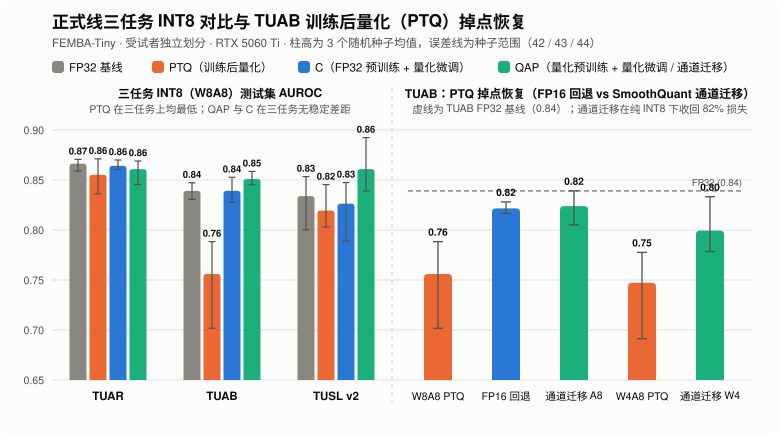
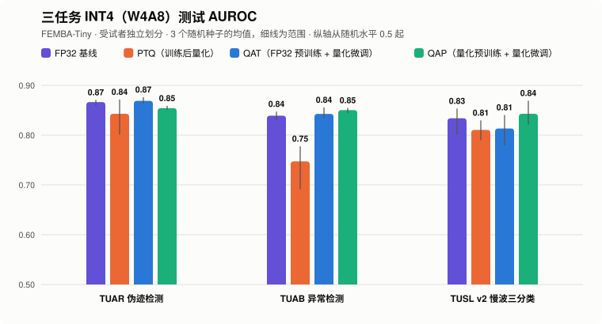

<div align="center">

# FEMBA-Tiny 脑电基础模型量化与位宽临界点研究

在脑电基础模型 FEMBA-Tiny（双向 Mamba，867 万参数）上比较三种量化方案：训练后量化（PTQ，post-training quantization）、FP32 预训练 + 量化微调（C）、量化预训练 + 量化微调（QAP，quantization-aware pretraining）。下游任务来自 TUH 脑电数据库：TUAR 伪迹检测、TUAB 异常检测、TUSL 慢波三分类。本页汇总 INT8 和 INT4；三值实验由队友负责，不在本仓库。

**TUAB 测试 AUROC：PTQ 0.76，C 0.84，QAP 0.85 · INT4 存储 4.85 MB（7.1×），精度不降 · QAP 与 C 持平**


[](LICENSE)

[问题与数据速查](#6-报告问题与数据速查索引) · [INT8 结果](reproduction/formal_line/results/int8/README.md) · [INT4 结果](reproduction/formal_line/results/int4/README.md) · [评测指标与成本](reproduction/formal_line/results/metrics/README.md) · [QAP 逐层分析](reproduction/formal_line/results/layers/README.md) · [PTQ 掉点定位](reproduction/formal_line/results/ptq-diagnosis/README.md) · [快速复现](#5-快速复现与多机分工)

<picture>
  <source media="(prefers-color-scheme: dark)" srcset="reproduction/figures/formal-overview-dark.svg">
  
</picture>

</div>

本页正式线实验采用受试者独立划分（预训练语料为 TUAB 官方训练集并剔除全部下游测试受试者），固定随机种子 42 / 43 / 44，使用 Brevitas 伪量化。C 是本仓库加的对照：预训练不带量化、微调带量化，用来单独看“预训练要不要带量化”。

## 立项问题速答

| 立项问题 | 答案 | 细节 |
| --- | --- | --- |
| **QAP 从哪个位宽开始优于 PTQ？** | 测过的 INT8、INT4 两档都已优于，没有出现交叉。TUAB 上 QAP 比 PTQ 的 AUROC 高约 `0.10`、BAcc 高约 `0.12`，从 8 位到 4 位差距不变；TUSL 上也更高；TUAR 换成验证集选的阈值后两者持平。 | [INT8](reproduction/formal_line/results/int8/README.md) · [INT4](reproduction/formal_line/results/int4/README.md) |
| **差距大到要改部署默认吗？** | 要改，但改成量化微调（C）就够：C 拿到同样的提升，QAP 对 C 没有稳定优势。 | [§1](#1-正式线主结果三任务-int8w8a8对比) · [§2](#2-正式线主结果三任务-int4w4a8对比) |
| **QAP 值得预训练成本的位宽** | 8 位、4 位都不值得。C 各位宽共用一份 FP32 预训练（`2.59 h`），QAP 每个位宽要单独预训练一次（INT8 单独占卡折算约 `3.0 h`）。 | [预训练成本](reproduction/formal_line/results/metrics/README.md#预训练成本) |
| **逐层：QAP 在哪里帮助最大？** | 第 2 个 Mamba 块，占 QAP 减小掉点的 `76%`（INT8）和 `72%`（INT4），三种子均值上以反向扫描输出最大。量化微调后，C、QAP 在这一块的截断比例都不超过 `0.02%`，PTQ 是 `4%`。 | [逐层分析](reproduction/formal_line/results/layers/README.md) |
| **部署建议** | 优先 INT4 + C：比 INT8 再省 `47%` 存储、`25%` BOPs，AUROC 与 FP32 相差不超过 `0.03`。PTQ 只有 TUAR 在验证集重选阈值后接近 C，TUAB、TUSL 都明显更差；必须用 PTQ 时，把第 2 块扫描输出的离群通道迁进下一层权重，TUAB 上不重训可收回 `82%`（INT8）和 `57%`（INT4）的掉点，TUAR 上没有效果。存储和 BOPs 是理论值，没有在设备上实测。 | [§4](#4-位宽压缩率推理计算量与训练耗时) · [PTQ 掉点定位](reproduction/formal_line/results/ptq-diagnosis/README.md) |
| **三种基线** | FP16、BF16 与 FP32 持平；各位宽的 PTQ 见 §1、§2；随机初始化（不加载预训练、直接量化微调）在 TUAB、TUAR 上与预训练模型持平，在 TUSL 上（不计第 0 组）低 `0.07–0.08`。 | [FP16 和 BF16](reproduction/formal_line/results/metrics/README.md#fp16-和-bf16) · [随机初始化](reproduction/formal_line/results/metrics/README.md#随机初始化) |
| **四项指标** | BAcc、ECE 见 §1、§2；每参数有效位数 `8.40 / 4.48 / 2.52`，合计 BOPs `86.4 / 64.7 / 53.8 G`（INT8 / INT4 / 三值）。 | [评测指标与成本](reproduction/formal_line/results/metrics/README.md) |
| **与 FEMBA on the Edge 对照** | 方向一致，数字不能直接比。论文只在 TUAB 上做量化：PTQ 在 W8A8、W4A8 下是 `0.77`、`0.71`，QAT 都回到 `0.88`（FP32 `0.89`）。本页 TUAB 的 PTQ 是 `0.76`、`0.75`，C、QAP 回到 `0.84–0.85`（FP32 `0.84`）。论文用 TUEG 预训练；本页只用 TUAB 训练集预训练 2 轮，微调只用五分之一的受试者，PTQ 做法也不同。 | [与上游协议的差异](reproduction/formal_line/results/int8/README.md#与上游协议的差异) |
| **交叉图** | 含三值的交叉图在小组报告里；本仓库 INT8、INT4 的逐项数字在两张结果页。 | [INT8](reproduction/formal_line/results/int8/README.md) · [INT4](reproduction/formal_line/results/int4/README.md) |

TUSL 的“第 0 组”是四个测试组中的第一组，55 个测试事件里 46 个来自同一名受试者，所以单列不计它的结果；v2 是验证集改为按人抽的协议，见 [INT8 结果](reproduction/formal_line/results/int8/README.md#tuslv2-为主v1-对照)。

## 1. 正式线主结果：三任务 INT8（W8A8）对比

下表汇总三个随机种子的测试集均值（两位小数）：包含 ROC 曲线下面积（AUROC）、平衡准确率（BAcc，TUAR 与 TUAB 按默认阈值 `0`，TUSL v2 按最大概率分类）与期望校准误差（ECE，15 等宽分箱，越低越好）。`C` 为 FP32 预训练 + 量化微调，`QAP` 为量化预训练 + 量化微调，`随机初始化` 为不加载预训练直接做量化微调。

| 任务 | 指标 | FP32 | PTQ | C | QAP | 随机初始化 |
| --- | --- | ---: | ---: | ---: | ---: | ---: |
| **TUAR** | AUROC ↑ | 0.87 | 0.86 | 0.86 | 0.86 | **0.87** |
| **TUAR** | 平衡准确率 BAcc ↑ | 0.75 | 0.63 | **0.76** | **0.76** | **0.76** |
| **TUAR** | 校准误差 ECE ↓ | 0.10 | 0.17 | 0.08 | 0.09 | **0.08** |
| **TUAB** | AUROC ↑ | 0.84 | 0.76 | 0.84 | **0.85** | **0.85** |
| **TUAB** | 平衡准确率 BAcc ↑ | 0.76 | 0.65 | 0.76 | **0.77** | **0.77** |
| **TUAB** | 校准误差 ECE ↓ | 0.03 | 0.06 | **0.02** | **0.02** | 0.03 |
| **TUSL v2** | 宏平均 AUROC ↑ | 0.83 | 0.82 | 0.83 | **0.86** | 0.82 |
| **TUSL v2（不计第 0 组）** | 宏平均 AUROC ↑ | **0.91** | 0.89 | 0.90 | 0.90 | 0.83 |
| **TUSL v2** | 宏平均 BAcc ↑ | 0.68 | 0.51 | 0.67 | **0.70** | 0.68 |
| **TUSL v2** | 校准误差 ECE ↓ | 0.11 | 0.16 | 0.12 | **0.05** | 0.12 |

若在验证集上重选分类阈值，PTQ 在 TUAR、TUAB 上的 BAcc 分别恢复到 `0.75` 与 `0.70`（其余各组变化不超过 `0.01`）。四位小数明细、逐种子标准差与配对差值见 [INT8 完整结果](reproduction/formal_line/results/int8/README.md) 与 [评测指标与成本](reproduction/formal_line/results/metrics/README.md)。

- **PTQ 的阈值偏移与校准退化**：TUAR 上 PTQ 的种子 42 在默认阈值 `0` 下把全部片段判为阳性（BAcc 跌至 `0.50`，ECE 达 `0.33`），用验证集重选阈值后恢复到 `0.73`；TUAB 上两种阈值下 PTQ 均比 C、QAP 低 `0.07–0.12`。
- **TUSL v2 第 0 测试组的单受试者效应**：四组全计时 QAP 比 C 高 `+0.03`，但这全部来自第 0 测试组（单名受试者占该组 55 个测试事件中的 46 个）；剔除第 0 组后，C 与 QAP 的宏平均 AUROC 完全相同（`0.9032` vs `0.9032`），且双双比随机初始化（`0.8272`）高 `+0.08`。

## 2. 正式线主结果：三任务 INT4（W4A8）对比

权重从 8 位降到 4 位（激活保持 8 位），C 与 QAP 依然保持 FP32 水平。下表口径与 INT8 相同：

<div align="center">
<picture>
  <source media="(prefers-color-scheme: dark)" srcset="reproduction/figures/formal-overview-int4-dark.svg">
  
</picture>
</div>

| 任务 | 指标 | FP32 | PTQ | C | QAP | 随机初始化 |
| --- | --- | ---: | ---: | ---: | ---: | ---: |
| **TUAR** | AUROC ↑ | **0.87** | 0.84 | **0.87** | 0.85 | **0.87** |
| **TUAR** | 平衡准确率 BAcc ↑ | 0.75 | 0.57 | **0.76** | 0.75 | **0.76** |
| **TUAR** | 校准误差 ECE ↓ | 0.10 | 0.24 | 0.09 | 0.09 | **0.08** |
| **TUAB** | AUROC ↑ | 0.84 | 0.75 | 0.84 | **0.85** | **0.85** |
| **TUAB** | 平衡准确率 BAcc ↑ | 0.76 | 0.65 | **0.77** | **0.77** | **0.77** |
| **TUAB** | 校准误差 ECE ↓ | 0.03 | 0.09 | **0.02** | **0.02** | 0.03 |
| **TUSL v2** | 宏平均 AUROC ↑ | 0.83 | 0.81 | 0.81 | **0.84** | 0.82 |
| **TUSL v2（不计第 0 组）** | 宏平均 AUROC ↑ | **0.91** | 0.88 | 0.90 | 0.90 | 0.83 |
| **TUSL v2** | 宏平均 BAcc ↑ | **0.68** | 0.49 | 0.65 | **0.68** | **0.68** |
| **TUSL v2** | 校准误差 ECE ↓ | 0.11 | 0.18 | **0.09** | **0.09** | 0.11 |

若在验证集上重选分类阈值，PTQ 在 TUAR、TUAB 上的 BAcc 分别恢复到 `0.74` 与 `0.69`。四位小数明细、逐种子差值和 TUSL 重抽样见 [INT4 完整结果](reproduction/formal_line/results/int4/README.md)。

- **相比 INT8 再省 47% 存储、50% 量化层算力而精度不降**：从 INT8 到 INT4，模型存储从 `9.10 MB` 降至 `4.85 MB`，量化层 BOPs 从 `43.6 G` 降至 `21.8 G`（合计 BOPs `86.4 → 64.7 G`），C 与 QAP 在三个任务上的 AUROC 变化均不超过 `0.02`。
- **C 与 QAP 依然不分高下**：INT4 下 `QAP − C` 的测试 AUROC 在 TUAR 上三个种子均为负（均值 `−0.015`），TUAB 上均值 `+0.008`（种子 44 为负），TUSL v2 不计第 0 组时仅差 `+0.003`（种子 44 为负）。这证实到 4 位权重为止，共用 FP32 预训练底座的 C 已足够。

## 3. TUAB 上 PTQ 掉点定位与 QAP 逐层归因

TUAB 上 W8A8 PTQ 比 FP32 低 `0.08`（`0.84 → 0.76`）。分别关掉权重或激活量化、再逐层单独量化激活后，掉点拆解如下：

| TUAB 量化设置 | 权重位宽 | 激活位宽 | 测试 AUROC | 相对 FP32 |
| --- | --- | --- | ---: | ---: |
| **FP32 基线** | FP32 | FP32 | 0.84 | — |
| **只量化 8 位权重（W8A32）** | 8 bit | FP32 | 0.84 | 0.00 |
| **只量化 4 位权重（W4A32）** | 4 bit | FP32 | 0.83 | −0.01 |
| **只量化三值权重（Ternary）** | 2 bit | FP32 | 0.60 | −0.24 |
| **只量化 8 位激活（W32A8）** | FP32 | 8 bit | 0.76 | −0.08 |
| **标准 W8A8 PTQ（95 百分位）** | 8 bit | 8 bit | 0.76 | −0.08 |

逐层排名、长尾比值和不重训的修复实验见 [PTQ 掉点定位](reproduction/formal_line/results/ptq-diagnosis/README.md)，与 QAP 的逐块、逐处掉点对比见 [QAP 逐层分析](reproduction/formal_line/results/layers/README.md)。

- **8 位和 4 位掉在激活，三值掉在权重**：只量化 8 位权重不掉点（`0.84`），4 位权重仅多掉 `0.01`（`0.83`）；三值只量化权重就跌到 `0.60`，必须靠量化训练（C 或 QAP）恢复。
- **掉点集中在第 2 个 Mamba 块的扫描输出，而非离群值最大的第 1 块**：长尾最重的 7 处激活都在第 1 个 Mamba 块，单独量化时验证 AUROC 掉点不超过 `0.005`；真正引起掉点的是**第 2 个 Mamba 块的双向状态空间扫描（SSM）输出**。把这两处离群通道平移进下一层权重后，不重训的 W8A8 PTQ 可恢复到 `0.82`；QAP 相对 PTQ 减小的掉点也有 **76%** 来自第 2 个 Mamba 块。
- **INT4 的逐层结论相同**：QAP 减小的掉点有 **72%** 来自第 2 个 Mamba 块，差距最大的仍是反向扫描输出。

## 4. 位宽压缩率、推理计算量与训练耗时

FEMBA-Tiny 共 867 万参数：98.0% 为量化卷积与线性层权重，0.4%（3.1 万）为走 8 位激活量化的位置编码，其余 1.7%（depthwise 卷积、归一化、状态空间参数与偏置）保持 FP32。单次 5 秒脑电片段（`22 × 1280`）的比特操作数（BOPs）与单卡 RTX 5060 Ti（16 GB）预训练耗时如下：

| 位宽设置 | 权重×激活 | 有效位数 | 模型存储 | 压缩比 | 量化层 BOPs | 合计 BOPs | 预训练耗时 |
| --- | --- | ---: | ---: | ---: | ---: | ---: | --- |
| **FP32** | 32 × 32 | 32.00 bit | 34.68 MB | 1.0× | 696.9 G | 739.8 G | 2.59 h（独占） |
| **BF16 / FP16** | 16 × 16 | 16.00 bit | 17.34 MB | 2.0× | 174.2 G | 184.9 G | — |
| **INT8** | 8 × 8 | 8.40 bit | 9.10 MB | **3.8×** | 43.6 G | 86.4 G | 约 3.0 h（折算） |
| **INT4** | 4 × 8 | 4.48 bit | 4.85 MB | **7.1×** | 21.8 G | 64.7 G | 6.24 h（并发） |
| **三值** | 2 × 8 | 2.52 bit | 2.73 MB | **12.7×** | 10.9 G | 53.8 G | — |

`合计 BOPs` 在量化层之上计入了状态空间扫描与 depthwise 卷积（在 INT8 / INT4 / 三值下保持 FP32，共 `42.9 G`）。16 位未量化基线中，BF16 在三任务上零溢出且与 FP32 相差不超过 `0.0002`，FP16 在第 1 个 Mamba 块反向扫描输出有 `0.03%–0.11%` 的 TUAB 测试片段溢出。下游微调单卡耗时（TUAB `1.93–2.25 h`、TUAR `0.87–1.23 h`、TUSL 每组 `2–3 min`）见 [评测指标与成本](reproduction/formal_line/results/metrics/README.md)。

## 5. 快速复现与多机分工

正式线完整协议、环境变量与多机分跑步骤以 **[reproduction/formal_line/README.md](reproduction/formal_line/README.md)** 为准。

```bash
# 0. 路径：SRC 是打好补丁的上游源码，STUDY 是运行目录，ART 是结果根目录（共享的 FP32 父模型也放这里）
export SRC=<源码目录> STUDY=<运行目录> ART=<结果根目录>

# 1. 安装正式线依赖（Python 3.11，PyTorch 2.7.1+cu128，Brevitas 0.12.1）
pip install --extra-index-url https://download.pytorch.org/whl/cu128 -r reproduction/formal_line/requirements-formal.txt

# 2. 检出上游模型源码（a2a4d44）并依次打入三个量化与三值补丁
git clone https://github.com/berumottovv00/BioFoundation.git "$SRC"
git -C "$SRC" checkout a2a4d441485efd8423c44b35d7448a30ccd44437
git -C "$SRC" apply "$PWD/reproduction/teammate_ptq/source.patch" \
                    "$PWD/reproduction/teammate_ptq/quantization-config.patch" \
                    "$PWD/reproduction/teammate_ptq/ternary-model.patch"

# 3. 把脚本拷进运行目录，再跑单种子微调、PTQ 七档校准与评估队列（以 INT4 为例，复用共享 FP32 父模型）
#    QAP 的微调要等同种子的 QAP 预训练完成；还没有时加 RUN_QAP=no，只跑 C 和 PTQ
cp reproduction/teammate_ptq/*.py reproduction/tusl_events/evaluate_events.py \
   reproduction/formal_line/*.sh reproduction/formal_line/*.py "$STUDY"/
cd "$STUDY"
FP32_PARENTS=given SEED=42 BITS=4 SCHEME=uniform \
  TASKS="tuar tuab tusl0-v2 tusl1-v2 tusl2-v2 tusl3-v2" LOG_SUFFIX=-all ./finetune_queue.sh
```

我们写的代码和结果都在 `reproduction/` 下；根目录的 `models/`、`tasks/`、`config/` 等是上游 pulp-bio/BioFoundation 的代码，正式线不直接用。

| 目录 | 内容 |
| --- | --- |
| `reproduction/formal_line/` | 正式线的运行脚本、手册和全部结果页（现行） |
| `reproduction/teammate_ptq/` | 正式线共用的训练、PTQ、评估脚本和三个源码补丁；其 README 的结果表是早期按录音划分的 TUAR 试点 |
| `reproduction/subject_split/`、`reproduction/tusl_events/` | 按受试者划分的 TUAR、TUAB 数据和 TUSL 事件数据的生成脚本 |
| `reproduction/RESULTS.md`、`reproduction/PROTOCOL.md` | 2025 公开权重的早期复现，已归档 |

## 6. 报告问题与数据速查索引

| 报告问题 / 评测指标 | 结果页 | 原始 JSON 与复算脚本 |
| --- | --- | --- |
| **INT8 三任务主指标**（AUROC、AP、种子标准差、配对差值与重抽样） | [INT8 完整结果](reproduction/formal_line/results/int8/README.md) | [summary.json](reproduction/formal_line/results/int8/summary.json) · [provenance.json](reproduction/formal_line/results/int8/provenance.json) · [verify_binary.py](reproduction/formal_line/results/int8/verify_binary.py) |
| **INT4 三任务主指标**（AUROC、AP、配对差值、重抽样与运行环境） | [INT4 完整结果](reproduction/formal_line/results/int4/README.md) | [summary.json](reproduction/formal_line/results/int4/summary.json) · [provenance.json](reproduction/formal_line/results/int4/provenance.json) · [tusl-bootstrap.json](reproduction/formal_line/results/int4/tusl-bootstrap.json) |
| **平衡准确率（BAcc）**（默认阈值 `0` vs 验证集阈值，及 TUSL 最大概率） | [评测指标与成本 §平衡准确率](reproduction/formal_line/results/metrics/README.md#平衡准确率) | [int8/summary.json](reproduction/formal_line/results/int8/summary.json) · [int4/summary.json](reproduction/formal_line/results/int4/summary.json) |
| **期望校准误差（ECE）**（15 等宽分箱，含 TUSL 剔除第 0 组对照） | [评测指标与成本 §校准误差](reproduction/formal_line/results/metrics/README.md#校准误差) | [calibration-error.json](reproduction/formal_line/results/metrics/calibration-error.json) · [calibration_error.py](reproduction/formal_line/calibration_error.py) |
| **16 位未量化基线**（BF16 与 FP16 三任务重放及 FP16 溢出位置统计） | [评测指标与成本 §FP16 和 BF16](reproduction/formal_line/results/metrics/README.md#fp16-和-bf16) | [half-precision.json](reproduction/formal_line/results/metrics/half-precision.json) · [half_precision.py](reproduction/teammate_ptq/half_precision.py) |
| **随机初始化基线**（不加载预训练直接做 INT8、INT4 量化微调，检验预训练收益） | [评测指标与成本 §随机初始化](reproduction/formal_line/results/metrics/README.md#随机初始化) | [random-init.json](reproduction/formal_line/results/metrics/random-init.json) · [run_random_init.sh](reproduction/formal_line/run_random_init.sh) |
| **模型成本**（有效位数、存储、量化层与合计 BOPs） | [评测指标与成本 §每参数有效位数](reproduction/formal_line/results/metrics/README.md#每参数有效位数和存储) | [model-cost.json](reproduction/formal_line/results/metrics/model-cost.json) · [model_cost.py](reproduction/formal_line/model_cost.py) |
| **训练耗时与卡型**（FP32、QAP 预训练和各微调） | [评测指标与成本 §预训练成本](reproduction/formal_line/results/metrics/README.md#预训练成本) | [int4/provenance.json](reproduction/formal_line/results/int4/provenance.json)（INT4 各阶段的起止时间和 GPU） |
| **逐样本测试分数**（算校准误差、画交叉图用） | [INT8 完整结果 §文件](reproduction/formal_line/results/int8/README.md#文件) | 不在仓库里，格式见该节 |
| **QAP 在哪一层减小掉点最多？**（TUAB INT8、INT4 按块 + 第 2 块逐处 + SQNR/截断率） | [QAP 逐层分析](reproduction/formal_line/results/layers/README.md) | [layers/seed*.json](reproduction/formal_line/results/layers/) · [layer_comparison.py](reproduction/teammate_ptq/layer_comparison.py) |
| **PTQ 掉点诊断与修复**（位宽拆解、MSE/KL 校准、FP16 回退、SmoothQuant 迁移、Hadamard 旋转） | [PTQ 掉点定位](reproduction/formal_line/results/ptq-diagnosis/README.md) | [ptq-diagnosis/summarize.py](reproduction/formal_line/results/ptq-diagnosis/summarize.py) · [channel_migration.py](reproduction/teammate_ptq/channel_migration.py) · [rotation_ptq.py](reproduction/teammate_ptq/rotation_ptq.py) |
| **正式线协议、数据划分与多机队列**（[subject_split](reproduction/subject_split/)、[tusl_events](reproduction/tusl_events/)、[teammate_ptq](reproduction/teammate_ptq/README.md)） | [正式线复现手册](reproduction/formal_line/README.md) · [早期 2025 权重归档](reproduction/RESULTS.md) | [finetune_queue.sh](reproduction/formal_line/finetune_queue.sh) · [summarize_formal.py](reproduction/formal_line/summarize_formal.py) |

## 上游来源与致谢

- **量化模型与 QAP 基线**：基于 [berumottovv00/BioFoundation](https://github.com/berumottovv00/BioFoundation/tree/a2a4d441485efd8423c44b35d7448a30ccd44437)（`a2a4d44`）。
- **FEMBA 原始论文与公开实现**：[pulp-bio/BioFoundation](https://github.com/pulp-bio/BioFoundation/tree/d88596590f3bd3fce573be07646b7d3977ce7bcc) · [FEMBA（EMBC 2025）](https://arxiv.org/abs/2502.06438v2) · [FEMBA on the Edge（IEEE TBME 2026）](https://arxiv.org/abs/2603.26716v1) · [Apache-2.0 License](LICENSE)。
