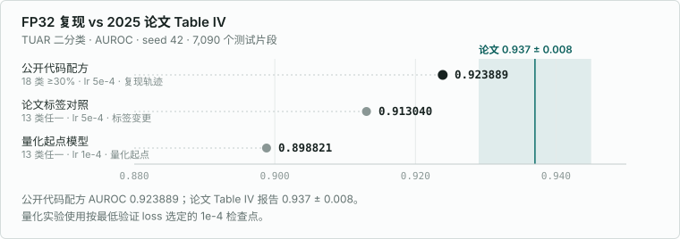
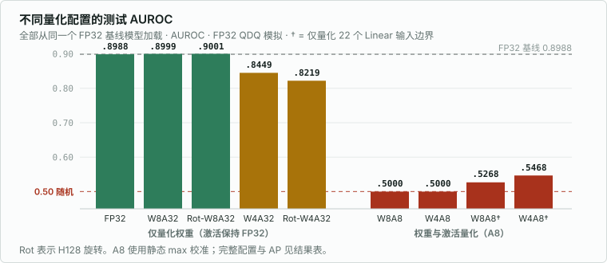

# 历史实验归档：2025 公开权重 TUAR 单种子结果

> **正式线（按受试者划分，覆盖 TUAR / TUAB / TUSL 三任务与 INT8 / INT4 / 三值）见 [reproduction/formal_line/](formal_line/README.md)。** 本页归档早期基于 2025 公开代码（`d885965`）与 `mamba-ssm` 在 TUAR 上（seed 42，按录音划分）完成的单种子实验：包括公开代码复现、静态最大值校准崩溃归因、FP16 溢出诊断与 Hadamard 旋转对照。

## 1. FP32 复现与论文对照

| FP32 配置 | 标签规则 / AdamW 学习率 | 测试 AUROC | 测试 AP | 说明 |
| --- | --- | ---: | ---: | --- |
| 公开代码默认设置 | 18 类、伪迹占比 ≥30% / `5e-4` | 0.923889 | 0.933093 | 最接近论文 Table IV（`0.937 ± 0.008`），相差 1.31 个百分点 |
| 论文 13 类标签（`5e-4`） | 13 类、任一出现 / `5e-4` | 0.913040 | 0.944898 | 改用论文标签定义重新训练 |
| 论文 13 类标签（`1e-4`） | 13 类、任一出现 / `1e-4` | **0.898821** | **0.938437** | 验证集交叉熵损失最低（`0.3937` vs `0.4270`），作为下文量化实验的共用 FP32 基线 |

- **标签定义的影响**：把 18 类（占比 ≥30% 判正）改为论文的 13 类（任一出现即判正）后，测试集有 618 个片段从负类变为正类，正类占比从 `49.03%` 升至 `57.74%`。直接拿第一组模型在新测试标签上重评，AUROC 为 `0.907507`；用新标签重新训练后升至 `0.913040`（`+0.55` 个百分点）。
- **学习率与选点**：`1e-4` 组在第 7 轮达到最低验证损失（`0.3937`），按预设选点规则选为后续量化实验的共用起点（对应下图虚线 `0.898821`）。

## 2. PTQ、FP16 与 Hadamard 旋转结果

所有版本均加载上述同一个 FP32 基线检查点（验证集 5,899 个片段，测试集 7,090 个片段）。

| 配置 | 测试 AUROC | 测试 AP | 准确率 (Accuracy) | 平衡准确率 (BAcc) | 现象 |
| --- | ---: | ---: | ---: | ---: | --- |
| **FP32 基线** | 0.898821 | 0.938437 | 83.55% | 84.47% | 正常 |
| **W8A32（只量化 8 位权重）** | 0.899945 | 0.938976 | 83.65% | 84.39% | 与 FP32 基本一致 |
| **W4A32（只量化 4 位权重）** | 0.844892 | 0.903830 | 57.67% | 49.96% | 99.82% 样本被判为正类 |
| **W8A8（57 处激活，浮点步长）** | 0.500000 | 0.577433 | 57.74% | 50.00% | 全部判为正类 |
| **W4A8（57 处激活，浮点步长）** | 0.500000 | 0.577433 | 57.74% | 50.00% | 全部判为正类 |
| **W8A8（57 处激活，2 的幂次步长）** | 0.500000 | 0.577433 | 57.74% | 50.00% | 全部判为正类 |
| **W8A8（只量化 22 个线性层输入）** | 0.526839 | 0.604017 | 57.74% | 50.00% | 排序略升，仍全部判为正类 |
| **W4A8（只量化 22 个线性层输入）** | 0.546794 | 0.619750 | 57.74% | 50.00% | 排序略升，仍全部判为正类 |
| **FP16（direct / state-safe / AMP）** | — | — | — | — | 第 1 个验证 batch 即溢出 `NaN` |
| **Rot-W8A32（H128 旋转 + 8 位权重）** | 0.900130 | 0.939189 | 83.61% | 84.44% | 与 FP32 基本一致 |
| **Rot-W4A32（H128 旋转 + 4 位权重）** | 0.821896 | 0.890039 | 57.62% | 49.90% | 比未旋转 W4A32 低 0.023 |
| **Rot-W8A8 / Rot-W4A8（H128 旋转）** | 0.500000 | 0.577433 | 57.74% | 50.00% | 末端激活归零，全部判为正类 |

### 为什么按最大值（`max_abs`）校准会让 W8A8 彻底崩溃？

掉点根因是**少数极大离群值把逐张量量化步长撑得过大，其余正常激活四舍五入后全变成了 0**：

- 以第 1 个 Mamba 块前向 `out_proj` 输入为例：校准集 2,048 个片段（约 2.52 亿个元素）中的最大绝对值为 `56,777,900`，按 `s = max_abs / 127` 算出的 INT8 步长达 `447,070`。
- 步长 `44.7 万` 意味着绝对值小于半步长（`22.4 万`）的所有非零数都会被四舍五入成 `0`。在验证与测试集的 16 亿个元素里，**99.9964% 的非零激活被直接归零**。
- 这正是后续正式线把激活校准改为**按验证集扫描百分位（90–99.999）**的原因。

### 为什么 FP16 在首个 batch 就产生 `NaN`？

从上表第 1 个 Mamba 块的激活峰值（`5.68 × 10⁷`）可以直接看出原因：IEEE 754 FP16 的最大可表示正数只有 `65,504`。哪怕把状态空间参数 `A_log`、`D`、`dt_proj.bias` 留在 FP32（`FP16-state-safe`）或开启 `AMP-FP16`，第 1 个 Mamba 块的激活在首个验证 batch（256 个片段）内就会超出 `65,504` 并溢出为 `NaN`（`mamba_blocks.0` 输出出现 6,545 个 `NaN`）。不改缩放时只能用指数位与 FP32 相同的 BF16。

### 为什么 Hadamard 旋转（H128）压低了峰值，Rot-W8A8 还是全判正类？

H128 正交旋转（遵循 [2026-09-22 RMS 协议](PROTOCOL.md#2026-09-22旋转数值检查修订)）确实把五处输出投影输入的绝对峰值压低了 **4.3–11.1 倍**：

| 输出投影输入位置 | 未旋转最大绝对值 | H128 旋转后最大绝对值 | 峰值缩小倍数 |
| --- | ---: | ---: | ---: |
| 第 1 个块，前向 `out_proj` 输入 | 56,777,900 | 5,267,555.5 | 10.8× |
| 第 1 个块，反向 `out_proj` 输入 | 25,163,848 | 2,338,181.5 | 10.8× |
| 第 2 个块，前向 `out_proj` 输入 | 57,324.6 | 6,988.7 | 8.2× |
| 第 2 个块，反向 `out_proj` 输入 | 320,374.7 | 28,820.3 | 11.1× |
| 分类头输入 | 82.8 | 19.2 | 4.3× |

但缩小 10 倍后，第 1 个块的峰值仍有 `527 万`（INT8 步长 `4.15 万`），前面各层依然有大量激活被归零；传到末端分类池化层 `classifier_pool_out` 时，测试集上的最大激活已衰减到 `0.0079`（Rot-W8A8）和 `0.0157`（Rot-W4A8），低于该层校准时固定的半步长 `0.0552`，导致最后一层 `fc3` 收到全零向量、只输出常数偏置（详见 [rotation_results.json](rotation_results.json)）。

## 3. 论文中“W8A8 PTQ AUROC 0.77”的出处说明

- [2025 FEMBA 原文（EMBC 2025）](https://arxiv.org/html/2502.06438v2) 只报告了 FP32 基线，没有做 W8A8 量化。
- `0.77` 出自后续论文 [FEMBA on the Edge（IEEE TBME 2026，Table VI）](https://arxiv.org/html/2603.26716v1#S4.SS3)：任务是 **TUAB**（而非 TUAR），W8A8 PTQ 的 AUROC 从 FP32 的 `0.89` 降到 `0.77`。

## 4. 归档数据文件

| 文件 | 一句话说明 |
| --- | --- |
| [upstream2025_results.json](upstream2025_results.json) | 修正梯度累积与 TF32 之前的初始运行记录（测试 AUROC `0.8992`） |
| [fp32_control_results.json](fp32_control_results.json) | 修正梯度累积与关闭 TF32 后的公开代码配方基线（测试 AUROC `0.9239`） |
| [paper_label_results.json](paper_label_results.json) | 论文 13 类伪迹标签映射、重评分与重训对照 |
| [lr_control_results.json](lr_control_results.json) | `5e-4` 与 `1e-4` 学习率对照及选定的 FP32 基线检查点信息 |
| [precision_results.json](precision_results.json) | W8/W4、57 处激活量化与三种 FP16 路径的完整评估记录 |
| [linear_scope_results.json](linear_scope_results.json) | 只量化 22 个线性层输入的对照记录 |
| [rotation_results.json](rotation_results.json) | 四个 H128 旋转配置的完整评估与末端激活统计 |
| [rotation_layout_results.json](rotation_layout_results.json) | 旋转矩阵结构校验与 6 项反向拦截测试记录 |
| [rotation_numeric_results.json](rotation_numeric_results.json) | 固定输入与权重下的 FP32 / FP64 旋转数值误差诊断 |
| [source_versions.json](source_versions.json) | 实验运行时的脚本与文件 SHA256 指纹 |

复现命令见 [PROTOCOL.md](PROTOCOL.md)。
