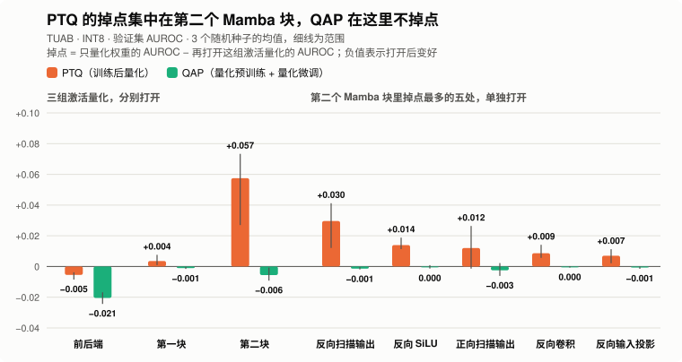

# 逐层分析：QAP 在哪里减小掉点最多

范围：TUAB，INT8（W8A8），验证集，种子 42 / 43 / 44。单模型 PTQ 掉点与修复对照见 [PTQ 掉点定位](../ptq-diagnosis/README.md)。

## 结论

1. **QAP 相对 PTQ 的优势集中在第二个 Mamba 块。** PTQ 在这里掉 0.057 AUROC，QAP 不掉，三个种子同向。QAP 减小的全部掉点里，这一块占 76%（0.063 / 0.083）。平衡准确率的结论相同。
2. **第二块里主要是反向分支。** 掉点差距最大的五处有四处在反向分支。反向扫描输出单独打开时，PTQ 掉 0.030，QAP 不掉。
3. **第一个 Mamba 块差别很小。** 两者的掉点差值只有 0.005。
4. **PTQ 在第二块截断得多。** 每处中位数有 4.05% 的数值超出量化范围，QAP 是 0.02%。

<picture>
  <source media="(prefers-color-scheme: dark)" srcset="../../../figures/layer-drop-dark.svg">
  
</picture>

## 怎么测

两个模型都先只量化权重，再打开一组激活量化，其余激活留在浮点。

- `掉点 = 只量化权重的指标 − 打开这组后的指标`（正值代表打开这组激活量化后指标下降，负值代表上升）
- `QAP 减小的掉点 = PTQ 掉点 − QAP 掉点`

QAP 的掉点全是负的：它带着激活量化训练，打开激活量化后指标反而更高。前后端的差值主要来自这一点，PTQ 在那里并不掉点。

| 指标 | PTQ 只量化权重 | PTQ 全开 | QAP 只量化权重 | QAP 全开 |
|---|---:|---:|---:|---:|
| AUROC | 0.8260 | 0.7717 | 0.8019 | 0.8279 |
| 平衡准确率，验证集阈值 | 0.7672 | 0.7198 | 0.7468 | 0.7744 |
| 平衡准确率，默认阈值 | 0.7635 | 0.6711 | 0.7327 | 0.7715 |

## 按块

三组掉点相加，和全开的掉点只差 0.001（三个种子的均值，单个种子最多差 0.008），所以可以分块看。

AUROC：

| 组 | 处数 | PTQ 掉点 | QAP 掉点 | QAP 减小的掉点 | 差值（42 / 43 / 44） |
|---|---:|---:|---:|---:|---:|
| 前后端 | 7 | −0.0055 | −0.0205 | +0.0150 | +0.0159 / +0.0166 / +0.0125 |
| 第一个 Mamba 块 | 14 | +0.0036 | −0.0011 | +0.0047 | +0.0079 / +0.0024 / +0.0037 |
| 第二个 Mamba 块 | 14 | +0.0575 | −0.0056 | +0.0631 | +0.0826 / +0.0277 / +0.0789 |

平衡准确率，验证集阈值：

| 组 | 处数 | PTQ 掉点 | QAP 掉点 | QAP 减小的掉点 | 差值（42 / 43 / 44） |
|---|---:|---:|---:|---:|---:|
| 前后端 | 7 | −0.0096 | −0.0200 | +0.0104 | +0.0072 / +0.0164 / +0.0075 |
| 第一个 Mamba 块 | 14 | +0.0032 | −0.0017 | +0.0049 | +0.0075 / +0.0020 / +0.0054 |
| 第二个 Mamba 块 | 14 | +0.0560 | −0.0067 | +0.0627 | +0.0911 / +0.0213 / +0.0757 |

平衡准确率，默认阈值：

| 组 | 处数 | PTQ 掉点 | QAP 掉点 | QAP 减小的掉点 | 差值（42 / 43 / 44） |
|---|---:|---:|---:|---:|---:|
| 前后端 | 7 | −0.0098 | −0.0304 | +0.0206 | +0.0224 / +0.0251 / +0.0144 |
| 第一个 Mamba 块 | 14 | +0.0044 | −0.0033 | +0.0077 | +0.0107 / +0.0049 / +0.0075 |
| 第二个 Mamba 块 | 14 | +0.0841 | −0.0089 | +0.0929 | +0.0937 / +0.0378 / +0.1473 |

## 第二个 Mamba 块逐处

14 处逐一单独打开，下表是掉点差距最大的五处，三个种子都为正。其余九处的差值都不超过 0.0034。

| 位置 | PTQ 掉点 | QAP 掉点 | QAP 减小的掉点 | 差值（42 / 43 / 44） |
|---|---:|---:|---:|---:|
| 反向扫描输出 | +0.0296 | −0.0014 | +0.0310 | +0.0416 / +0.0373 / +0.0140 |
| 正向扫描输出 | +0.0121 | −0.0025 | +0.0146 | +0.0047 / +0.0090 / +0.0301 |
| 反向 SiLU 激活后 | +0.0140 | −0.0001 | +0.0141 | +0.0118 / +0.0179 / +0.0126 |
| 反向卷积后 | +0.0086 | −0.0001 | +0.0087 | +0.0053 / +0.0141 / +0.0068 |
| 反向输入投影后 | +0.0070 | −0.0007 | +0.0077 | +0.0078 / +0.0128 / +0.0026 |

## 量化误差

SQNR（信号与量化噪声的功率比，越高误差越小）和截断比例（超出量化范围的数值占比）在前 512 个验证片段上统计，所有量化器全开。表中是每组各处的中位数，再对三个种子取均值。

| 组 | PTQ SQNR（dB） | QAP SQNR（dB） | PTQ 截断比例 | QAP 截断比例 |
|---|---:|---:|---:|---:|
| 前后端 | 14.2 | 34.2 | 5.06% | 0.01% |
| 第一个 Mamba 块 | 24.7 | 22.8 | 2.18% | 0.01% |
| 第二个 Mamba 块 | 12.0 | 27.9 | 4.05% | 0.02% |

SQNR 低不一定掉点：前后端的 PTQ 也只有 14.2 dB，却没有掉点。

## 文件

- [seed42.json](seed42.json)、[seed43.json](seed43.json)、[seed44.json](seed44.json)：每处的 AUROC、平衡准确率、SQNR 和截断比例。
- [layer_comparison.py](../../../teammate_ptq/layer_comparison.py)：测量脚本。
- [plot_layer_drop.py](../../../figures/plot_layer_drop.py)：画图。
