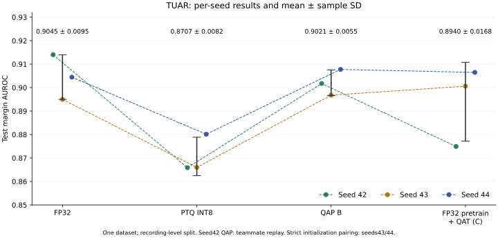
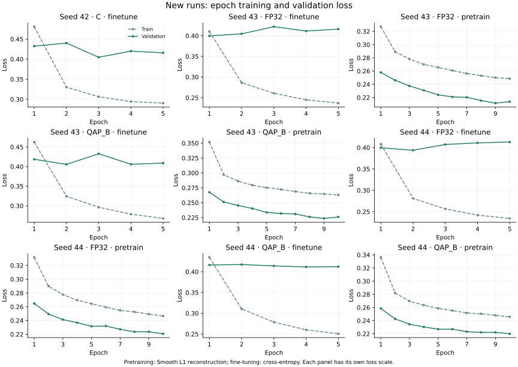
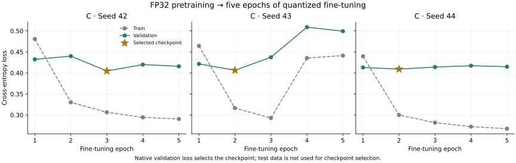

# 详细说明：TUAR 按录音划分的 FP32、PTQ、C 与 QAP 对照

[返回概览](README.md)

基于上游仓库 [berumottovv00/BioFoundation](https://github.com/berumottovv00/BioFoundation/tree/a2a4d441485efd8423c44b35d7448a30ccd44437)（`a2a4d44`）、同一份按录音划分的 TUAR 数据和全部 7,211 个测试片段。模型包含 8,670,626 个参数，`dt_rank=96`。

## 三种子结果

随机种子为 42、43、44，下表为均值 ± 样本标准差。PTQ 各自从同种子的 FP32 微调检查点校准，百分位档位和分类阈值均在验证集上选定。

| 方法 | AUROC | AP | 默认阈值 BAcc | 验证集阈值 BAcc |
| --- | ---: | ---: | ---: | ---: |
| FP32 基线 | 0.9045 ± 0.0095 | 0.9233 ± 0.0061 | 83.08 ± 0.19% | 82.76 ± 0.60% |
| PTQ INT8 | 0.8707 ± 0.0082 | 0.8871 ± 0.0068 | 62.74 ± 11.07% | 77.06 ± 1.68% |
| QAP（量化预训练 + 量化微调） | 0.9021 ± 0.0055 | 0.9194 ± 0.0041 | 81.83 ± 0.70% | 82.12 ± 0.72% |
| C（FP32 预训练 + 量化微调） | 0.8940 ± 0.0168 | 0.9147 ± 0.0152 | 81.77 ± 1.67% | 81.80 ± 1.68% |



QAP 在三个种子上都高于 PTQ，同种子 AUROC 差值为 **+0.0314 ± 0.0041**；PTQ 相对 FP32 为 **−0.0338 ± 0.0126**；QAP 与 FP32 的均值只差 −0.0024。

种子 42 的 QAP 使用队友提供的检查点在 WSL 复测；种子 43、44 在本机从头训练，预训练初值、9:1 验证划分和分类头初值与同种子 FP32 完全一致。单看严格同初始化的种子 43、44，QAP 减 PTQ 的 AUROC 为 **+0.0292 ± 0.0022**。

<details>
<summary>逐种子 AUROC 与 PTQ 选定百分位</summary>

| 种子 | FP32 | PTQ INT8 | QAP | C | QAP − C | PTQ 选定百分位 |
| --- | ---: | ---: | ---: | ---: | ---: | ---: |
| 42 | 0.914010 | 0.865885 | 0.901722 | 0.874904 | +0.026818 | 95 |
| 43 | 0.894974 | 0.865982 | 0.896775 | 0.900574 | −0.003799 | 99.9 |
| 44 | 0.904437 | 0.880125 | 0.907740 | 0.906471 | +0.001269 | 95 |

[完整结果](c-seed-results.json) 包含准确率、混淆矩阵、判正类比例、阈值、检查点哈希和同种子差值；[上一轮结果](seed-results.json) 记录补齐种子 43/44 C 组之前的九个训练阶段；上游单取正类 logit `z1` 的历史指标见 [历史结果](results.json) 的 `teammate_report`。

</details>

## PTQ 校准与阈值选择

PTQ 固定抽取训练集里同一批 512 个片段（抽样种子 42，batch 32），同时开启 35 个激活量化器和 18 个权重量化器。候选百分位共七档（99.999、99.99、99.9、99、98、95、90），按验证集 AUROC 选档（并列时依次按验证 AP、交叉熵损失选择），选定后再评测试集。

AUROC 与 AP 用正负类 logit 差 `float64(z1) - float64(z0)` 计算。默认分类阈值为 0；验证集阈值在 6,426 个验证片段上搜索使平衡准确率（BAcc）最大的点。平移阈值只改变分类判定，不改变 AUROC 和 AP。

种子 43 的 PTQ AUROC 有 0.8660，但默认阈值 0 把 99.94% 的测试片段判为正类，导致默认 BAcc 只有 49.98%；改用验证集选出的阈值后，判正类比例回到 62.79%，BAcc 升至 75.80%。

种子 42 在七档候选中按验证集选出 95 百分位（验证 AUROC 0.8479，测试 0.8659）；90 百分位下验证 AUROC 会跌到 0.8201（见 [七档对照](results.json)）。

## C 组：FP32 预训练 + 量化微调

三个种子的 C 组各自加载同种子的 FP32 预训练检查点（已训 10 轮、15,610 步），直接开启量化微调 5 轮（8,675 步，batch 32）。

加载 FP32 预训练权重后，编码器的 34 个激活量化器与新分类头的第 35 个激活量化器都在首个训练 batch 重新统计尺度。种子 42、43、44 按最低验证损失选出的微调轮次分别为第 3、2、2 轮。

QAP 减 C 的 AUROC 在三个种子上均值为 **+0.0081 ± 0.0164**；在随机初始化完全相同的种子 43、44 上为 **−0.0013 ± 0.0036**（验证集阈值 BAcc 差为 **−0.68 ± 1.21** 个百分点）。早期只看单种子 42（+0.0268）会误以为量化预训练有效，补齐三个种子后这一差距消失。

## 训练曲线



预训练为掩码重建损失，微调为分类交叉熵损失。种子 43、44 的 FP32 与 QAP 各训预训练 10 轮、微调 5 轮。



[种子 42 预训练损失与学习率](curves/pretrain-loss-lr.svg) · [种子 42 微调损失与学习率](curves/finetune-loss-lr.svg) · [单取正类 logit `z1` 的验证 AUROC](curves/native-positive-logit-auroc.svg)。

## 超参数与运行入口

| 项目 | 设置 |
| --- | --- |
| 训练 | batch 32；预训练 AdamW 1e-4（10 轮）；微调 AdamW 5e-5、weight decay 0.5、预热 1 轮、逐层衰减 0.75（5 轮）；按最低验证损失选检查点 |
| 数据 | 按录音划分 TUAR：训练 55,524、验证 6,426、测试 7,211 个片段（测试集负类 3,304、正类 3,907） |
| 输入 | `22 × 1280`；固定上下界归一化 `(x + 20) / (40 + 1e-8)`；关闭 HDF5 内存缓存 |
| 推理 | RTX 5060 Ti；batch 32；开启 TF32；Brevitas 伪量化 |

`source.patch` 提供量化开关与 PTQ 校准入口；`quantization-config.patch` 支持配置权重与激活位宽（默认 W8A8）：

```bash
git clone https://github.com/berumottovv00/BioFoundation.git teammate-source
git -C teammate-source checkout a2a4d441485efd8423c44b35d7448a30ccd44437
git -C teammate-source apply /path/to/this-repo/reproduction/teammate_ptq/source.patch
git -C teammate-source apply /path/to/this-repo/reproduction/teammate_ptq/quantization-config.patch
```

训练与评估命令见 [TRAINING.md](TRAINING.md)；INT4、混合位宽与三值权重接口见 [QUANTIZATION.md](QUANTIZATION.md)。`export_curves.py` 从 TensorBoard 导出 CSV 与 SVG 曲线，`summarize_seeds.py` 与 `summarize_c_followup.py` 汇总各阶段指标与文件哈希。
