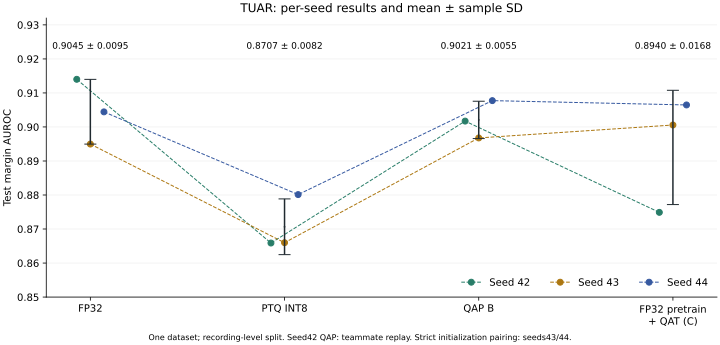
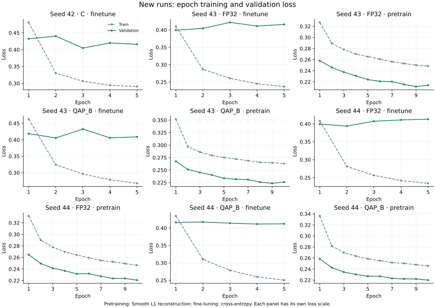
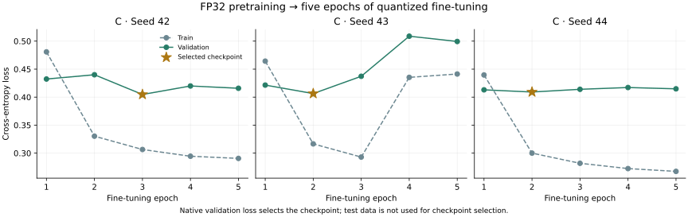

# 详细说明：上游仓库模型的 FP32、PTQ、QAP B 与 C 对照

[返回概览](README.md)

使用上游仓库 berumottovv00/BioFoundation 的[固定提交](https://github.com/berumottovv00/BioFoundation/tree/a2a4d441485efd8423c44b35d7448a30ccd44437)、同一份 TUAR 数据和完整的 7,211 个测试窗口。模型为 ARES 版本，8,670,626 个参数，实际 `dt_rank=96`。

## 三种子结果

训练种子为 42、43、44，下表为均值 ± 样本标准差。PTQ 各自由对应种子的 FP32 权重校准，档位和分类阈值均在验证集上选择。

| 方法 | AUROC | AP | 默认 BAcc | 验证阈值 BAcc |
| --- | ---: | ---: | ---: | ---: |
| FP32 | 0.9045 ± 0.0095 | 0.9233 ± 0.0061 | 83.08 ± 0.19% | 82.76 ± 0.60% |
| PTQ INT8 | 0.8707 ± 0.0082 | 0.8871 ± 0.0068 | 62.74 ± 11.07% | 77.06 ± 1.68% |
| QAP B | 0.9021 ± 0.0055 | 0.9194 ± 0.0041 | 81.83 ± 0.70% | 82.12 ± 0.72% |
| C | 0.8940 ± 0.0168 | 0.9147 ± 0.0152 | 81.77 ± 1.67% | 81.80 ± 1.68% |



QAP B 在三个种子上都高于 PTQ，AUROC 同种子差值为 **0.0314 ± 0.0041**；PTQ 相对 FP32 为 **−0.0338 ± 0.0126**。QAP B 与 FP32 的平均 AUROC 相差 −0.0024。

seed42 的 QAP B 使用上游仓库作者提供的检查点在 WSL 复测；43/44 为本机按原配方重训，并核对了预训练初值、9:1 划分和分类头初值。单独看严格配对的 43/44，QAP−PTQ 的 AUROC 为 **0.0292 ± 0.0022**。

<details>
<summary>逐种子 AUROC 与 PTQ 档位</summary>

| 种子 | FP32 | PTQ INT8 | QAP B | C | QAP B−C | PTQ 所选百分位 |
| --- | ---: | ---: | ---: | ---: | ---: | ---: |
| 42 | 0.914010 | 0.865885 | 0.901722 | 0.874904 | +0.026818 | 95 |
| 43 | 0.894974 | 0.865982 | 0.896775 | 0.900574 | −0.003799 | 99.9 |
| 44 | 0.904437 | 0.880125 | 0.907740 | 0.906471 | +0.001269 | 95 |

[完整结果](c-seed-results.json) 包含 Accuracy、混淆矩阵、判正类比例、阈值、检查点哈希和配对差值。[上一轮结果](seed-results.json) 保留原来的九个训练阶段和来源。上游仓库原报告的 `z1` 指标保留在 [历史结果](results.json) 的 `teammate_report` 中。

</details>

## 校准与阈值

PTQ 固定 512 个训练窗口，抽样种子 42、batch 32，35 个激活和 18 个权重量化器全部开启。七档候选为 99.999、99.99、99.9、99、98、95、90，按验证 AUROC 选档，AP、CE loss 和固定顺序用于破除并列，选择锁定后才测测试集。

AUROC/AP 使用 `float64(z1)-float64(z0)`。默认分类阈值为 margin 0；另一列阈值只在 6,426 个验证窗口上最大化 BAcc，并列时取离 0 最近、再取较低的阈值。调整阈值不改变 AUROC/AP。

seed43 的 PTQ AUROC 为 0.8660，默认阈值却把 99.94% 的测试窗口判为正类，BAcc 为 49.98%；验证集阈值下判正类比例降到 62.79%，BAcc 为 75.80%。这说明排序能力和输出分布偏移需要分别看。

seed42 扩展到七档后选出 P95：验证 AUROC 0.8479，测试 0.8659。此前 P99 的测试 0.8717 保留为历史对照；七档汇总采用验证集选出的 P95。[七档对照](results.json) 中 P90 的验证 AUROC 降到 0.8201。

## C 组：FP32 预训练后量化微调

C42/43/44 各从已有同 seed 的 FP32 预训练检查点开始，仅开启量化微调 5 轮、8,675 步，batch 32。父预训练均已完成 10 轮、15,610 步；本次 C43/44 没有重跑预训练。

三组均核对 34 个共享激活 observer 加载后保持未统计状态；加上新分类头共 35 个，首批均重新统计。43/44 分类头初值与各自 FP32/QAP B 相同，加载的 encoder 与同 seed FP32 父模型一致。最低原生验证 loss 选出的最佳轮次分别为第 3、2、2 轮。

QAP B−C 的 AUROC 全三种子为 **+0.008096 ± 0.016411**；严格配对 43/44 为 **−0.001265 ± 0.003583**。对应验证阈值 BAcc 差为 **+0.321 ± 1.933** 和 **−0.679 ± 1.211** 个百分点。C43/44 补齐后，不支持此前仅依据 C42 将性能差距归因于量化预训练的判断。

## 训练曲线



预训练为重建 loss，微调为分类交叉熵，各子图独立纵轴。43/44 的 FP32 与 QAP 均完成预训练 10 轮、微调 5 轮；C42 完成微调 5 轮，共 65 轮。微调 loss 的最优轮次随种子变化，所有组都按验证 loss 选检查点。



C43/44 新增两次 5 轮微调，与上图九个阶段合计 75 轮。新队列六个 train/eval/curves 阶段均退出 0；完整验证/测试 logits 的独立复算及源码、数据、父检查点哈希验收通过，GPU 已释放。

[seed42 预训练 loss/学习率](curves/pretrain-loss-lr.svg) · [seed42 微调 loss/学习率](curves/finetune-loss-lr.svg) · [原生 `z1` 验证 AUROC](curves/native-positive-logit-auroc.svg)。原生曲线保留训练时的指标口径；主表统一用 margin。

## 设置与运行

| 项目 | 设置 |
| --- | --- |
| 训练 | batch 32；预训练 AdamW 1e-4；微调 AdamW 5e-5、weight decay 0.5、warmup 1 轮、分层衰减 0.75；原生 val_loss 选检查点 |
| 数据 | train 55,524、val 6,426、test 7,211；测试负类 3,304、正类 3,907 |
| 输入 | 22×1,280；`(x+20)/(40+1e-8)`；HDF5 样本缓存关闭 |
| 推理 | RTX 5060 Ti；batch 32；TF32 开启；INT8 使用原生 Brevitas 伪量化 |

补丁增加量化开关和原生 PTQ 校准函数，保留模型结构；FP32 存档中的未统计激活状态在加载进量化模型后会重新统计。

```bash
git clone https://github.com/berumottovv00/BioFoundation.git teammate-source
git -C teammate-source checkout a2a4d441485efd8423c44b35d7448a30ccd44437
git -C teammate-source apply /path/to/this-repo/reproduction/teammate_ptq/source.patch
```

[训练与评估命令](TRAINING.md) 包含 FP32、QAP B、C 和七档 PTQ 的入口。`export_curves.py` 从 TensorBoard 导出标量 CSV/SVG；`summarize_seeds.py` 保留上一轮三种子统计，`summarize_c_followup.py` 增量合并 C43/44，生成当前四组统计和图表。

`seed-results.json` 记录上一轮实际执行文件和私有驱动哈希；`c-seed-results.json` 单独记录 C43/44 的冻结源码、运行入口及原件哈希，并引用上一轮结果。实际执行源码为固定 base 加未提交补丁，保留 `dirty=true`；源文件、重建补丁与公开汇总脚本的哈希分别记录。数据集、权重、逐样本输出和原始日志留在仓库外。

测试命令见 [训练文档](TRAINING.md#验证)。
