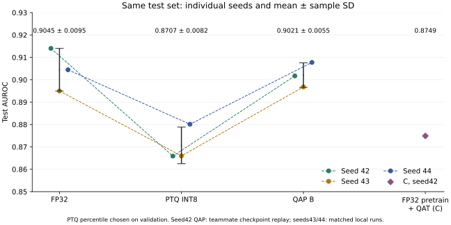

# 上游仓库模型的 int8 对比：FP32 / PTQ / QAP

模型与 QAP 方法来自上游仓库 [berumottovv00/BioFoundation](https://github.com/berumottovv00/BioFoundation)。

**结论**：在上游仓库的模型和 TUAR 数据上压缩到 8 位，“训练时就带着压缩”（QAP）基本不掉分，“训完再压缩”（PTQ）掉了一截。三个随机种子的结果一致。

| 模型 | AUROC（三个种子平均） | 比 FP32 |
| --- | ---: | ---: |
| FP32（不压缩） | 0.9045 | — |
| QAP int8（上游仓库的方法） | 0.9021 | −0.0024 |
| PTQ int8（训完再压缩） | 0.8707 | −0.0338 |

- **QAP 比 PTQ 高约 0.03**，三个种子都是 QAP 更高。
- **PTQ 的输出整体偏向“有伪迹”**：测试集里真正有伪迹的占 54%，但用默认判断线时，PTQ 把 80%–100% 的样本都判成有伪迹；只用验证集重新选判断线后，平衡准确率回到约 77%（FP32 约 83%）。
- **C 组**（先正常预训练，最后带着压缩微调）：0.875，接近 PTQ。说明关键在于预训练阶段就带着压缩。目前只有一个种子。

**适用范围**：只测了 TUAR 一个任务；数据按录音划分，不是按人；模型完全沿用上游仓库的代码。

## 用这套流程跑 int4 / 三值

1. 取上游仓库的[固定版本](https://github.com/berumottovv00/BioFoundation/tree/a2a4d441485efd8423c44b35d7448a30ccd44437)，打上 [`source.patch`](source.patch)。补丁只加了量化开关和校准函数，不改模型结构。
2. 按 [TRAINING.md](TRAINING.md) 的顺序跑：数据校验 → FP32 和 QAP 训练 → 评估与 PTQ 校准 → 汇总结果。
3. 现在的脚本里写死了 8 位，跑 int4 / 三值之前要先改成可配置。

## 更多细节

- [详细说明](DETAILS.md)：校准档位和判断线怎么选、C 组、训练曲线、实验设置
- [逐种子结果](seed-results.json)：每个种子的全部指标、阈值和哈希
