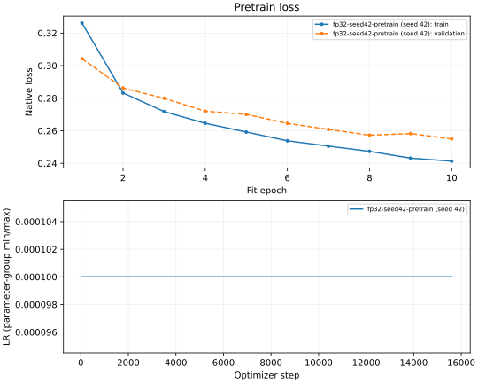
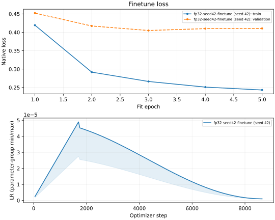

# 队友模型的 FP32、PTQ 与 QAP 对照

使用 [队友代码的固定提交](https://github.com/berumottovv00/BioFoundation/tree/a2a4d441485efd8423c44b35d7448a30ccd44437) 和同一份 TUAR 数据。
模型为 ARES 版本，8,670,626 个参数，实际 `dt_rank=96`。seed 42，预训练 10 轮、微调 5 轮，按最低验证 loss 保存检查点。

## 结果

完整测试集 7,211 个窗口，负类 3,304、正类 3,907。各组使用同一套预处理、样本顺序与指标。
PTQ 均来自同一 FP32 检查点；QAP B 使用队友预训练及量化微调的检查点。

| 模型 | AUROC | 默认阈值 BAcc | 验证集阈值 BAcc |
| --- | ---: | ---: | ---: |
| FP32 | 0.9140 | 83.27% | 83.43% |
| 原 PTQ INT8 | 0.6925 | 49.28% | 66.73% |
| P99 PTQ INT8 | 0.8717 | 50.09% | 76.86% |
| P95 PTQ INT8（七档验证集选定） | 0.8659 | 68.48% | 76.42% |
| 队友 QAP B | 0.9017 | 81.98% | 82.18% |

AUROC/AP 统一使用两类 logit 的差值 `z1-z0`；上游使用单列 `z1`。QAP B 行来自收到的检查点在 WSL 的完整测试。原生指标和队友报告参考值一并保存在结果 JSON 中。

扩展校准固定比较 99.999、99.99、99.9、99、98、95、90 七档，按验证集 AUROC 选 P95，AP、CE loss 和固定顺序用于破除并列。七档统一使用 `z1-z0` 后，验证 AUROC 并非单调变化：P99.9 为 0.8454，P95 为 0.8479，P90 降到 0.8201。

<details>
<summary>七档验证集 AUROC</summary>

| 激活百分位 | AUROC |
| --- | ---: |
| 99.999 | 0.6901 |
| 99.99 | 0.8023 |
| 99.9 | 0.8454 |
| 99 | 0.8417 |
| 98 | 0.8392 |
| **95** | **0.8479** |
| 90 | 0.8201 |

</details>

P95 默认判正类比例为 80.56%，低于 P99 的 99.82%；验证集选出的概率阈值为 0.780837，测试判正类比例为 61.89%，Accuracy 为 77.23%。P95 的测试 AUROC 略低于此前 P99 的 0.8717，表中保留两组结果。

各组阈值只在 6,426 个验证窗口上最大化 Balanced Accuracy；并列时取离默认阈值最近、再取较低的阈值。先保存选择，再测测试集。调整阈值不改变 AUROC/AP，也不改变权重和量化尺度。

[完整数值与来源](results.json) 包含 AP、Accuracy、混淆矩阵、阈值和数据/权重哈希。

## 设置

| 项目 | 设置 |
| --- | --- |
| 训练 | batch 32；预训练 AdamW 1e-4；微调 AdamW 5e-5、weight decay 0.5、warmup 1 轮、分层衰减 0.75 |
| 输入 | 22×1,280；固定归一化 `(x+20)/(40+1e-8)`；HDF5 样本缓存关闭 |
| PTQ | 同一份 FP32 权重；seed 42 固定抽取 512 个训练窗口；35 个激活、18 个权重量化器全部开启 |
| 校准 | 原生 Brevitas 百分位统计，按调用求平均；激活候选为 99.999 至 90 的七档，权重量化保持原设置 |
| 推理 | RTX 5060 Ti；batch 32；FP32 执行；TF32 开启；INT8 使用原生 Brevitas 伪量化 |

P99 为此前四档校准选出的对照；P95 为扩展七档后按正确排序分数选出的方案。

## 运行

在实验环境中固定队友代码并应用补丁。补丁只增加量化开关和原生 PTQ 校准函数，保留模型结构。

```bash
git clone https://github.com/berumottovv00/BioFoundation.git teammate-source
git -C teammate-source checkout a2a4d441485efd8423c44b35d7448a30ccd44437
git -C teammate-source apply /path/to/this-repo/reproduction/teammate_ptq/source.patch
```

补丁保留 FP32 检查点中“尚未统计”的激活状态；加载到量化模型后会重新统计，供 C 组量化微调使用。旧结果保留对应补丁版本；新增校准使用修复后的补丁，均记录在 `results.json`。

下列路径由运行者提供；数据目录包含 `train.h5`、`val.h5`、`test.h5`。输出目录使用仓库外的新目录。

```bash
study=/path/to/this-repo/reproduction/teammate_ptq
teammate_source=/path/to/teammate-source
data=/path/to/TUAR_data
artifacts=/path/to/artifacts

python "$study/calibrate.py" --source "$teammate_source" --data "$data" \
  --checkpoint "$artifacts/fp32.ckpt" --percentile 99.999 --output "$artifacts/ptq-original"
python "$study/calibrate.py" --source "$teammate_source" --data "$data" \
  --checkpoint "$artifacts/fp32.ckpt" --percentile 99.0 --output "$artifacts/ptq-p99"
python "$study/evaluate.py" --source "$teammate_source" --data "$data" \
  --fp32 "$artifacts/fp32.ckpt" --ptq-original "$artifacts/ptq-original/ptq_int8.ckpt" \
  --ptq-p99 "$artifacts/ptq-p99/ptq_int8.ckpt" --qap-b "$artifacts/qap-b.ckpt" \
  --output "$artifacts/captures"
python "$study/threshold_control.py" --captures "$artifacts/captures" \
  --output "$artifacts/thresholds"
```

`calibrate.py` 只读取训练数据，保存后严格重载，核对浮点参数、53 个量化尺度和探针输出。`evaluate.py` 保存有序 logits；`threshold_control.py` 只用验证输出选择阈值。

从同一 FP32 权重重新校准七档并选择验证集方案：

```bash
python "$study/sweep.py" --source "$teammate_source" --data "$data" \
  --fp32 "$artifacts/fp32.ckpt" --output "$artifacts/seven-percentiles"
```

## 训练曲线




预训练验证 loss 整体下降，第 10 轮最低；微调验证 loss 在第 3 轮最低，后两轮训练 loss 继续下降，验证 loss 略回升，因此选用第 3 轮检查点。[原生验证 AUROC 曲线](curves/native-positive-logit-auroc.svg) 保留训练时的 `z1` 口径；上表采用 `z1-z0`。

`export_curves.py --manifest runs.json --output /path/to/new-curves` 导出完整标量 CSV 和 SVG。清单示例：

```json
{"runs":[{"run":"fp32-seed42-finetune","stage":"finetune","seed":42,"epochs":5,"tensorboard_dir":"/path/to/exact/tensorboard/run"}]}
```

CSV 保留重复的最终验证事件；图只取训练预算内每轮首条记录。已有 seed 42 导出 19,038 条标量，来源 event 文件哈希见结果 JSON。

训练配置及完整覆盖参数保存在 `results.json` 的 `training` 字段。环境版本见 `runtime` 字段。数据集、检查点、逐样本输出和原始日志保存在本地。

```bash
FEMBA_SOURCE="$teammate_source" python -m unittest discover -s "$study" -p 'test_*.py' -v
```
